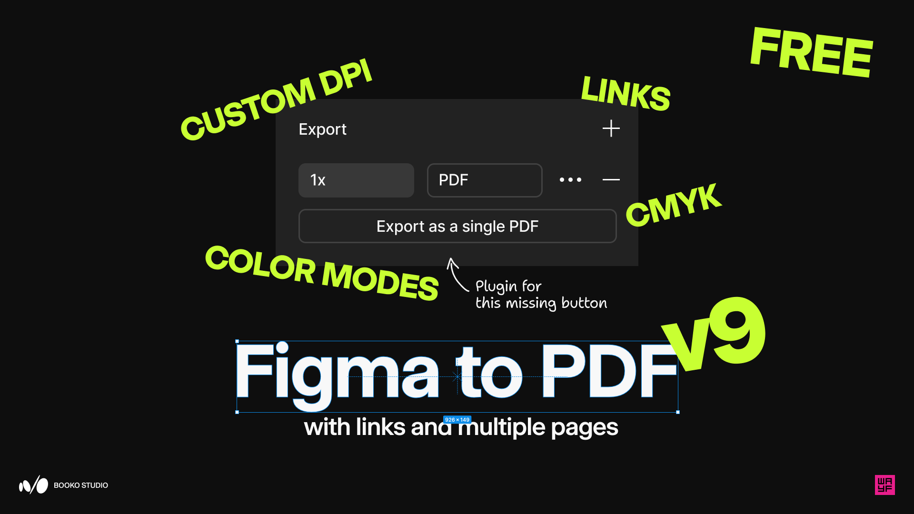

# v9.0.0

Release candidate prepared on October 28, 2026. Publication status is recorded in the GitHub release and the Community version history.

## What's new

- **A simpler two-screen interface.** Build your frame list, then choose export settings. Every listed frame is included. Drag to reorder, sort names A–Z/Z–A, or right-click to remove. Settings and custom profiles stay selected when you return to the list. Help appears on hover or keyboard focus.
- **72 DPI by default.** In Vector mode, Quality reduces supported embedded images while retaining vectors and text. Choose **More → Original** to keep Figma's image resolution, or select 36–300 DPI. Rasterized mode has its own page-resolution setting. Higher settings cannot add detail missing from the source.
- **Rebuilt PDF export and links.** Native whole-frame export preserves supported vectors, page sizes and precise text-link regions. Internal navigation, web links, rotated frames and repeated frame names have improved handling. Source layers are not hidden or rewritten during export.
- **More control over large exports.** Choose PNG or JPEG for RGB raster pages and vector fallbacks, allow oversized raster pages to use a lower resolution, or split the export into smaller PDFs. Save each part before continuing; cancellation and errors stop further downloads.
- **RGB color choices and offline CMYK beta.** **As file** is the default, with explicit sRGB and Display P3 options. CMYK uses the built-in ISO Coated v2 300% (basICColor/FOGRA39 coated paper) profile or your printer's custom ICC profile. Conversion runs locally without uploading designs or profiles.

## Before exporting

RGB Vector mode can fall back to a whole-page image when native export or an effect is unsupported; the plugin reports this. Vector CMYK supports a tested subset of Figma PDF content and stops on unsupported pages. Rasterized CMYK remains available, turns text into pixels and composites transparency onto white.

CMYK is experimental: colors, transparency and sampled gradients can look different. The built-in profile is for a specific coated-paper printing condition. Use your printer's profile and proofing process. This is not PDF/X and does not provide spot colors, overprint controls or guaranteed pure-black text.

Large files still have pixel and PDF-data limits. Keep split files together with their original filenames; links between parts require a compatible desktop PDF viewer. Save each part and continue within 15 minutes. Keep source frames unchanged until export finishes. Links with missing or ambiguous geometry are omitted with a warning.

The final v9.0.0 package passed **264 automated tests**. Its executable code matches the dev.9 checkpoint, which passed CI and a native macOS Figma smoke test; release packaging adds embedded dependency license notices. Earlier large-file checks include 156-page RGB and CMYK exports. These results do not guarantee every design, viewer or printing condition. See [interface validation](../INTERFACE.md), [large-file limits](../LARGE-EXPORTS.md) and [CMYK behavior](../VECTOR-CMYK.md).

## Release artwork

Artwork supplied by the plugin author and exported from Figma for this release.
